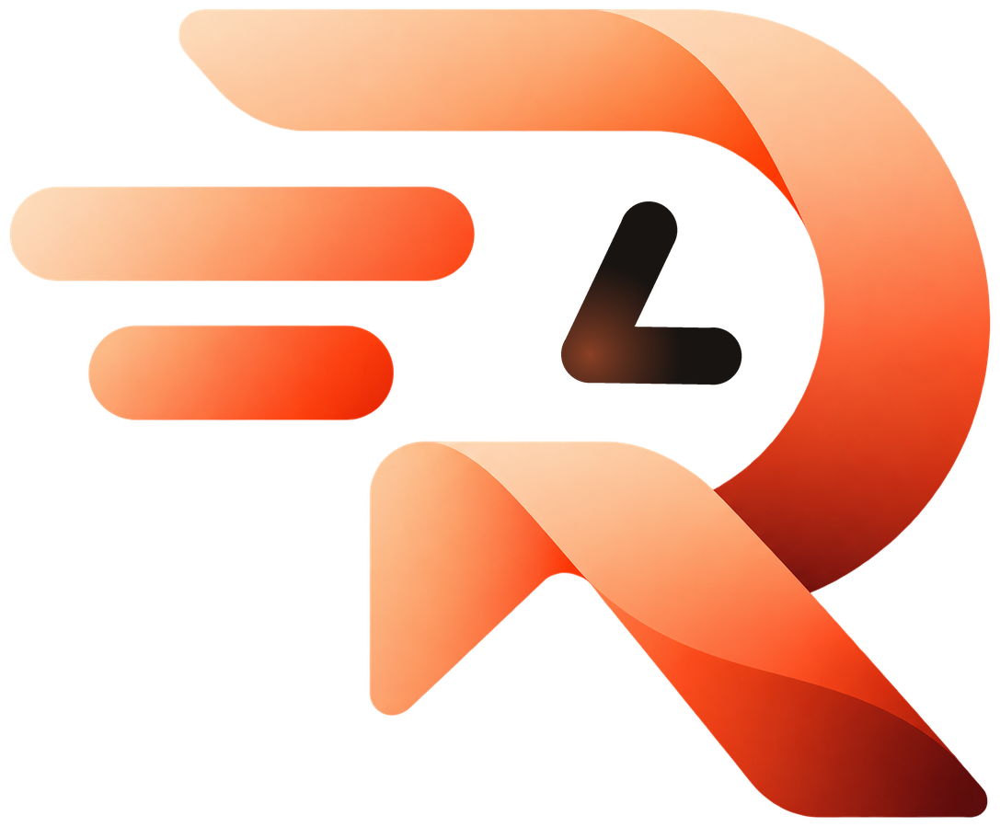
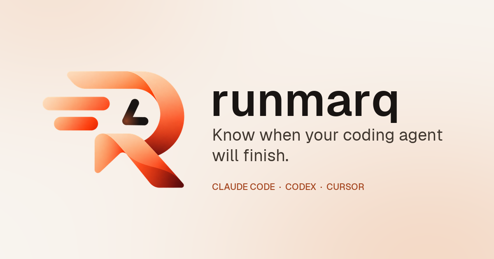
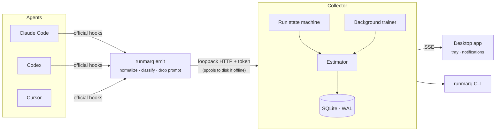

<div align="center">

<picture>
  <source media="(prefers-color-scheme: dark)" srcset="docs/brand/runmarq-logo-dark.png">
  
</picture>

# runmarq

### Know when your coding agent will finish.

A local-first desktop companion for **Claude Code**, **Codex** and **Cursor**.<br>
Live progress, calibrated ETAs, and a quiet ping when your agent finishes, fails or needs you.

[](https://github.com/arjunpundeer7/runmarq/actions/workflows/ci.yml)
[](#license)
[](https://www.rust-lang.org)
[](https://v2.tauri.app)
[](#install)
[](#status)

[How it works](#how-it-works) ·
[Install](#install) ·
[CLI](#the-runmarq-command) ·
[Privacy](#privacy-by-construction) ·
[Architecture](#architecture) ·
[Contributing](#contributing)

<br>



</div>

<br>

## Why

You hand an agent a task, then you wait. Is it two minutes or twenty? Is it stuck on a failing test, or waiting for your approval in a terminal you can't see?

runmarq answers that. It follows every agent **run** (one prompt, one agent turn) through the agents' official hook interfaces, predicts the time remaining as a **range with stated confidence**, and tells you the moment the run ends.

> [!NOTE]
> Nothing leaves your machine. Prompts are classified in memory and discarded. Source code, commands and their output are never stored. Estimates come from models trained locally on your own runs, with no model or API calls.

## Highlights

<table>
<tr>
<td width="50%" valign="top">

**Calibrated ETAs, not guesses**<br>
A likely range (P25–P75) with confidence, conformally calibrated on your own history. While uncertain, it leads with a plain outlook: *almost done*, *a few minutes*, *time for something else*.

</td>
<td width="50%" valign="top">

**Knows when it needs you**<br>
Notifications for finished, failed and waiting-for-approval runs, plus stuck detection: repeated tool failures, commands far slower than usual, runs long past their estimate.

</td>
</tr>
<tr>
<td valign="top">

**Three agents, one view**<br>
Claude Code, Codex and Cursor through documented hooks. Setup previews every change, backs up your config, verifies, and removes cleanly.

</td>
<td valign="top">

**Private by construction**<br>
Loopback-only collector with a bearer token. Prompt text never crosses a process boundary. Hooks always exit 0 and never alter agent behaviour.

</td>
</tr>
<tr>
<td valign="top">

**Desktop and terminal**<br>
Tauri app with tray, compact panel, history, insights and usage. Or stay headless: `runmarq status`, `runmarq wait`, and a one-line `statusline` for tmux and prompts.

</td>
<td valign="top">

**Honest by default**<br>
Accuracy metrics stay hidden until enough runs exist. A run with no reported end is *cancelled* or *unknown*, never *completed*. Limitations are listed, not hidden.

</td>
</tr>
</table>

## How it works



1. **A hook fires.** Each agent event runs `runmarq emit`, which parses the payload, classifies the prompt in memory, drops it, and forwards a minimized event. About 1 ms of work, and it always exits 0.
2. **The collector routes it.** Events join sessions and runs; a state machine tracks `running`, `waiting_for_user`, `blocked`, `completed`, `failed`, `cancelled` and `unknown`, separating active from waiting time.
3. **The estimator forecasts.** On every event and every 15 seconds, several models produce quantiles that are pooled and calibrated.
4. **You get told.** The desktop app and CLI subscribe to a live stream; notifications are deduplicated.

### The estimator

| Component | What it contributes |
|---|---|
| **History baseline** | Log-normal survival model, shrunk through disjoint cohorts (global → category → agent → repository), conditioned on time already elapsed |
| **Phase simulation** | Semi-Markov model of tool phases with learned tool and command durations, played forward at the run's own pace |
| **Similar prompts** | Nearest finished runs by salted term-vector sketch; text cannot be recovered |
| **Gradient boosting** | Quantile GBM over 60 features, enabled after 100 finished runs and validated on unseen ones |
| **Calibration** | Linear pooling with weights chosen by pinball loss on rolling-origin validation, then split-conformal intervals per forecast age |

Run `runmarq eval` to replay your own history and see how the estimates would have held up. The full explanation is in the [architecture overview](docs/architecture/overview.md#estimator).

## Supported agents

| Agent | Support | Mechanism | Notes |
|---|:---:|---|---|
| **Claude Code** | ✅ Available | Hooks in `settings.json` | Prompts, tools, plans, approvals, subagents, model and token usage |
| **Codex** | 🟡 Limited | `hooks.json` + `runmarq run` wrapper | Requires Codex 0.130+; no tool-failure or interrupt hooks upstream |
| **Cursor** | 🟡 Limited | Observer-only `hooks.json` | No tool-start or approval events, by design; no token counts |

Full capability matrix: [`packages/contracts/integrations.json`](packages/contracts/integrations.json). Codex and Cursor have been checked against their documented hook formats; live reports are very welcome.

## Install

<a id="status"></a>

> [!IMPORTANT]
> **Status: pre-release.** The collector, estimator, three integrations, CLI, desktop app and website are implemented and tested (290+ Rust tests, typed contracts, Playwright suite). There are no signed public builds yet, so for now runmarq is built from source.

**Requirements:** Rust stable (1.85+), Node.js 20.9+, pnpm 9, and the [Tauri prerequisites](https://v2.tauri.app/start/prerequisites/) for your platform.

```bash
git clone https://github.com/arjunpundeer7/runmarq.git
cd runmarq
pnpm install
cargo build --release -p runmarq-cli
```

**Headless (collector + one integration):**

```bash
target/release/runmarq collector start
target/release/runmarq integrations setup claude --dry-run   # preview the change
target/release/runmarq integrations setup claude
target/release/runmarq status
```

**Desktop app:**

```bash
pnpm dev:desktop       # development
pnpm build:desktop     # release bundles (CLI sidecar + Tauri)
```

> [!TIP]
> Set `RUNMARQ_HOME=/some/dir` to keep all data in a sandbox while experimenting.

## The `runmarq` command

| Command | What it does |
|---|---|
| `runmarq status` | Collector state and active runs |
| `runmarq wait` | Block until the current run ends; exit with its outcome. Shows progress on the terminal tab in Windows Terminal, Ghostty, WezTerm and ConEmu |
| `runmarq statusline` | One short line for a shell prompt, tmux or Claude Code |
| `runmarq run -- codex` | Run an agent under runmarq, preserving its terminal, signals and exit code |
| `runmarq integrations list \| setup \| verify \| remove` | Manage agent hooks, with `--dry-run` and `--project` |
| `runmarq doctor` | Check installation, collector, integrations and hook latency |
| `runmarq history` · `export` · `forget` | Browse, export as CSV, or delete run history |
| `runmarq eval` | Replay recorded runs to score the estimator |
| `runmarq collector start \| stop \| status` | Control the local collector |

Add `--json` to `status`, `doctor`, `history` and the integration commands for machine-readable output.

## Privacy by construction

| Stored | Never stored |
|---|---|
| Run timing, state, category, counts | Prompt text |
| Tool names, durations, minimized events | Source code, file contents |
| Salted hashes of repositories and commands | Command lines, tool input and output |
| Token counts from transcripts *(optional)* | Transcript text or paths |
| Git diff line counts *(optional)* | Names of changed files |
| Titles and folder names *(opt-in, redacted)* | Environment variables, tokens |

- The collector binds **127.0.0.1 only**, requires a bearer token, and rejects any request carrying an `Origin` header or a non-loopback `Host` (no CORS, no DNS rebinding).
- The webview never sees the token; it talks to the native side through typed Tauri commands.
- Agent configuration is changed only with approval, after a backup, by atomic write.

Read the [data inventory](docs/privacy/data-inventory.md) and [threat model](docs/privacy/threat-model.md).

## Architecture

```
runmarq/
├── crates/
│   ├── core/         Event contract, run state machine, forecast and API types (→ TypeScript via ts-rs)
│   ├── storage/      SQLite: WAL, versioned migrations, parameterized queries
│   ├── estimator/    Classifier, baseline, phase simulation, similar prompts, GBM, conformal calibration
│   ├── adapters/     Claude Code, Codex, Cursor: detect, install, verify, remove, normalize
│   ├── collector/    Run engine, probes, trainer, authenticated loopback API, spool, lifecycle
│   └── cli/          The runmarq binary
├── apps/
│   ├── desktop/      Tauri 2 + React: onboarding, overview, history, insights, usage, tray, panel
│   └── web/          Next.js website and documentation
├── packages/
│   ├── contracts/    Generated TS types, formatters, capability and release manifests
│   ├── ui/           Design tokens and the shared run card
│   └── config/       Brand file and shared ESLint config
├── fixtures/         Contract-derived vendor hook payloads for tests
└── docs/             Architecture, integrations, privacy, development
```

**Stack:** Rust · Tokio · Axum · rusqlite · Tauri 2 · React · Vite · Next.js · TypeScript · Turborepo · pnpm

Design rationale lives in [docs/architecture/decisions.md](docs/architecture/decisions.md).

## Development

```bash
pnpm check            # rustfmt, clippy -D warnings, cargo tests, typecheck, lint, JS tests
pnpm test:e2e         # website Playwright suite (build the site first)
pnpm contracts        # regenerate TypeScript contracts from Rust types
pnpm demo             # regenerate the website demo from the real engine
pnpm dev:web          # website at localhost
```

Guides: [setup](docs/development/setup.md) · [testing](docs/development/testing.md) · [releasing](docs/development/release.md) · [deploying](docs/development/deploy.md) · [integration research](docs/integrations/research.md)

## Roadmap

- [ ] Signed builds for Windows and macOS
- [ ] Public GitHub releases with checksummed installers
- [ ] Live-verified Codex and Cursor integrations
- [ ] Signed auto-updates
- [ ] More agents via the adapter interface

Ideas and votes welcome in [Discussions](https://github.com/arjunpundeer7/runmarq/discussions).

## Contributing

Contributions are welcome. Start with [CONTRIBUTING.md](CONTRIBUTING.md); the ground rules are short:

- **Never fake compatibility.** Documented vendor interfaces only.
- **Never weaken privacy defaults.** New event fields need a privacy review.
- **Never turn ambiguity into success.**
- **No invented numbers.**

Adding a new agent touches only the adapters crate, one enum and fixtures. Found a vulnerability? See [SECURITY.md](SECURITY.md).

## License

Licensed under either of

- Apache License, Version 2.0 ([LICENSE-APACHE](LICENSE-APACHE))
- MIT license ([LICENSE-MIT](LICENSE-MIT))

at your option. Unless you explicitly state otherwise, any contribution intentionally submitted for inclusion in this work, as defined in the Apache-2.0 license, shall be dual licensed as above, without any additional terms or conditions.

<div align="center">
<br>
<sub>runmarq is not affiliated with Anthropic, OpenAI or Anysphere. Claude Code, Codex and Cursor are trademarks of their respective owners.</sub>
</div>
